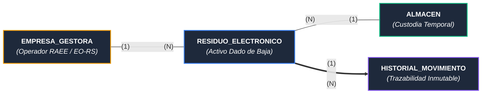
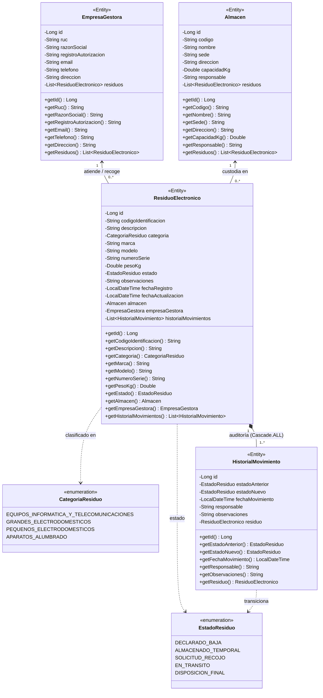
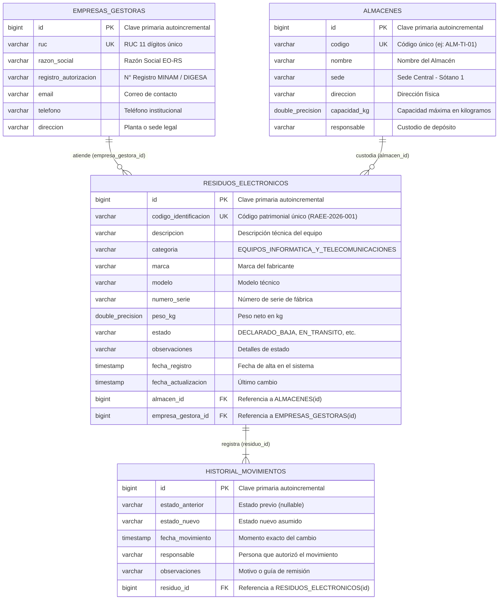
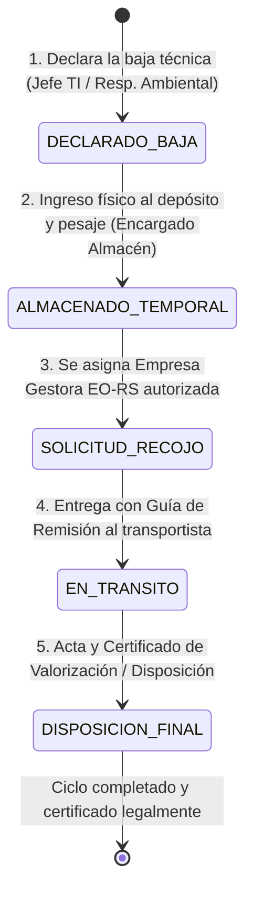
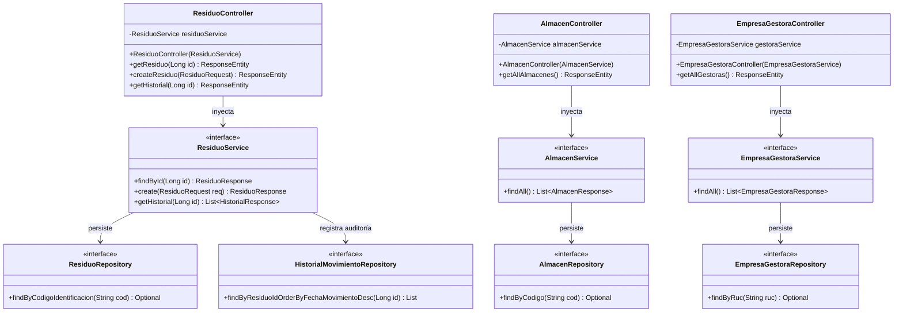
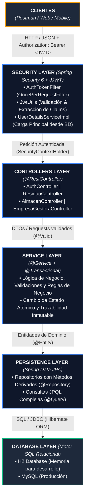
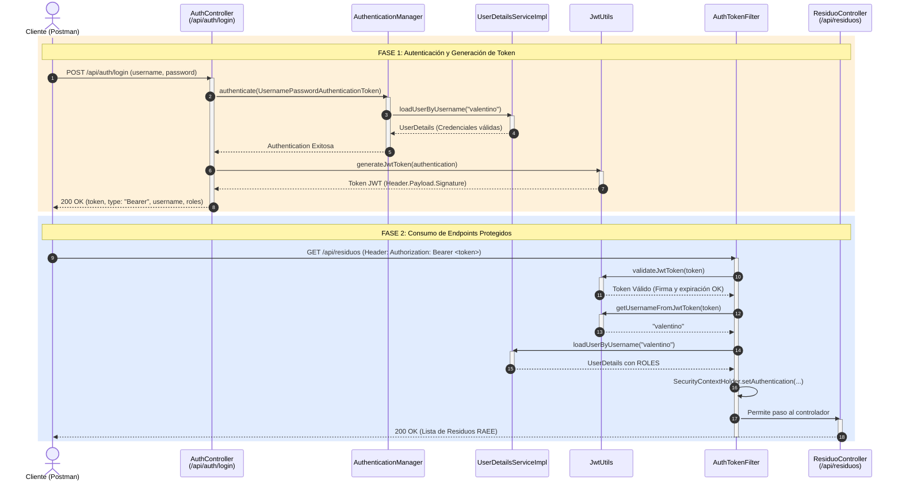

# 📐 Diagramas Oficiales EcoTechTrack (APF1 / APF2 - UTP)
### Sistema de Trazabilidad y Fiscalización de RAEE (D.S. N° 009-2019-MINAM)

Este documento contiene los códigos exactos en **Mermaid** que coinciden al 100% con las entidades, atributos y relaciones de tu **Informe de Word oficial**. Puedes previsualizarlos en Markdown o copiarlos directamente a tu informe.

---

## 1. 📌 Diagrama Conceptual del Modelo de Dominio (Para Sección 1.4 del Word)

Representa la cardinalidad de la arquitectura base:
- Una **Empresa Gestora** atiende múltiples residuos `(1:N)`.
- Un **Almacén** custodia múltiples residuos `(1:N)`.
- Cada **Residuo Electrónico** posee una colección cronológica de eventos de trazabilidad `(1:N)`.

---

## 2. 🏛️ Diagrama de Clases UML Formal (Para Sección 3.1 del Word)

Cajas con **3 compartimentos estándar** (Nombre, Atributos tipados con visibilidad `-`, y Métodos públicos `+`), junto con los `Enums`:

---

## 3. 🗄️ Diagrama Entidad-Relación de Base de Datos (Relacional con PK / FK / UK)

Estructura SQL física generada por Hibernate:

---

## 4. 🔄 Ciclo de Vida y Máquina de Estados del Residuo (Para Sección 3.3 del Word)

Representa el flujo inmutable de auditoría:

---

## 5. 🏗️ Arquitectura en Capas Spring Boot (Para Sección 2.2 del Word)

Inyección de dependencias por constructor sin `@Autowired`:

---

## 6. 🌐 Diagrama de Arquitectura Global y Capas de Seguridad

---

## 7. 🔐 Diagrama de Secuencia: Flujo de Autenticación con JWT (JSON Web Tokens)

